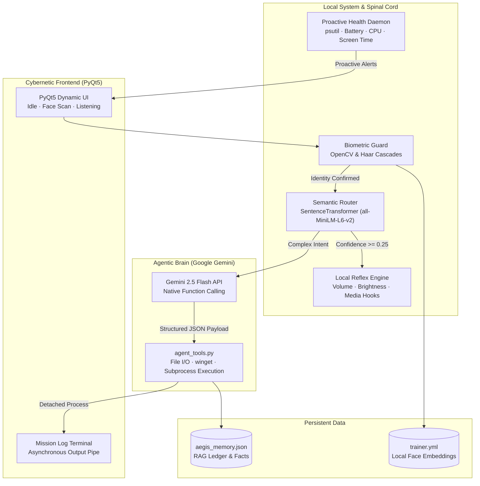
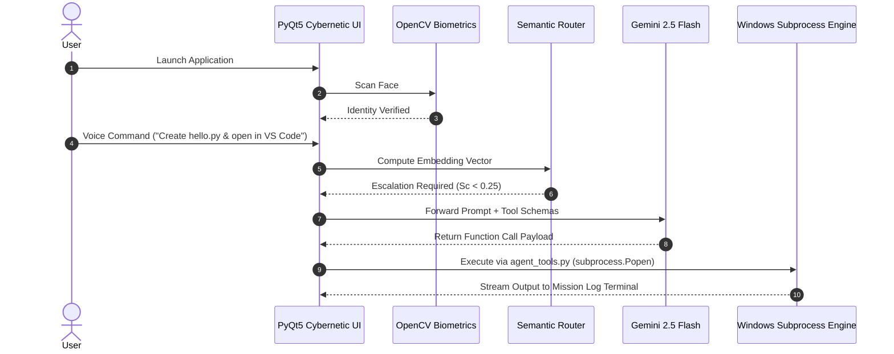
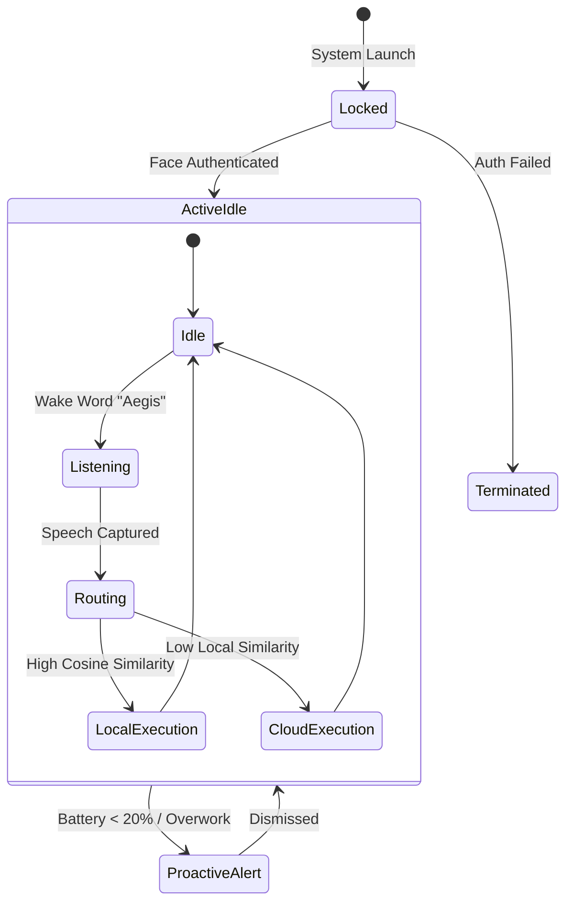
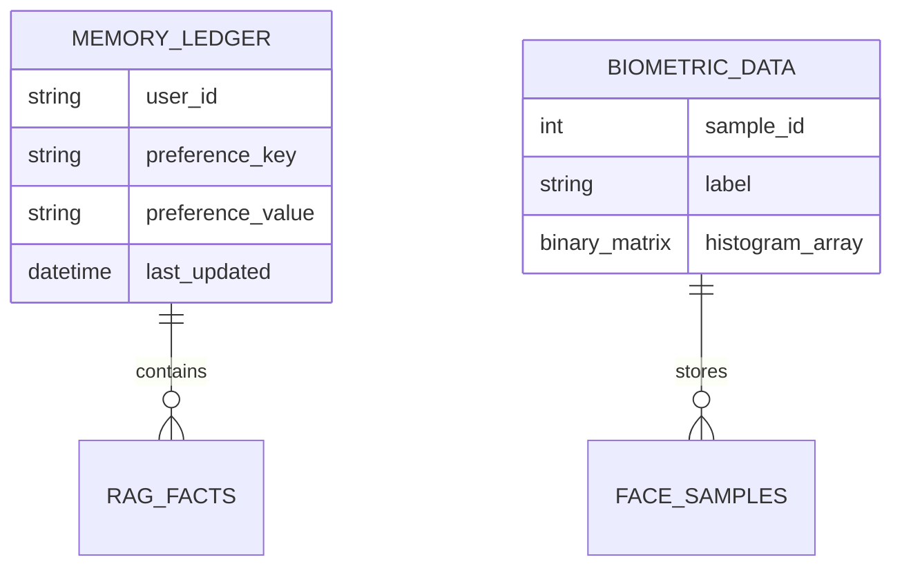
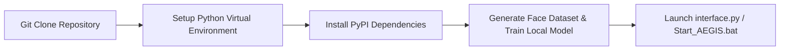

<div align="center">

# **AEGIS**

**An autonomous, proactive, and agentic AI ecosystem for desktop control and system management.**
Local vector routing runs the reflexes. Gemini Function Calling executes complex tasks. Biometric security protects the system.

[**Live Repository**](https://github.com/YashAI060/AEGIS-Agentic-AI) ·
[**Demo Video**](https://youtu.be/D7kuOhj_XjU?si=TrIwqbK5f1zxD6Rh) ·
[**Devpost Submission**](https://devpost.com/software/aegis-7ta4xu) ·
Built for **Gemini Live Agent Challenge**, theme *Agentic AI & Productivity* ·
Deployed on **Local Windows OS**

<br>

<a href="https://youtu.be/D7kuOhj_XjU?si=TrIwqbK5f1zxD6Rh" title="Watch the AEGIS demo video">
  
</a>

<sub>Click to view repository & assets. Everything in it was recorded on the live local environment with real hardware biometrics and voice command execution.</sub>

</div>

---

## Contents

1. [The problem](#1-the-problem)
2. [What AEGIS does](#2-what-aegis-does)
3. [Where the human comes in](#3-where-the-human-comes-in)
4. [Try it as a judge](#4-try-it-as-a-judge)
5. [System architecture](#5-system-architecture)
6. [How a command runs](#6-how-a-command-runs)
7. [The agents](#7-the-agents)
8. [Features](#8-features)
9. [Fake commands and misuse](#9-fake-commands-and-misuse)
10. [Reliability](#10-reliability)
11. [Data model](#11-data-model)
12. [API and modules](#12-api-and-modules)
13. [Deployment](#13-deployment)
14. [Run it locally](#14-run-it-locally)
15. [Project structure](#15-project-structure)
16. [Limits and what’s next](#16-limits-and-whats-next)
17. [Team and credits](#17-team-and-credits)

---

## <a id="1-the-problem"></a>1. The problem

Every developer secretly dreams of building their own J.A.R.V.I.S.—an assistant that doesn't just talk, but actually does things. However, most modern voice assistants suffer from two major flaws:
- **Entirely Reactive:** They only act when explicitly spoken to and cannot monitor system health, battery levels, or user break cycles proactively.
- **Lack of Agentic Execution:** They are limited to cloud text answers and cannot manage local files, write code, run terminals, or install software on a user's machine.

AEGIS bridges this gap by introducing an autonomous desktop companion that continuously monitors system health proactively, routes queries locally to protect data privacy, and utilizes function-calling to take complete control of the OS desktop environment.

---

## <a id="2-what-aegis-does"></a>2. What AEGIS does

| Who | What they get |
|---|---|
| **Developer / Power User** | Hands-free OS control, instant file creation, multi-line code generation, automated app launching, and silent software installation via `winget`. |
| **System Administrator** | Continuous daemon background monitoring of CPU, RAM, screen time, and battery health with collision-avoidance logic (`IS_BUSY` flag) to prevent voice interjections. |
| **Privacy-Focused User** | Local intent routing via SentenceTransformers (`all-MiniLM-L6-v2`) to execute basic OS reflexes offline without sending data to cloud servers. |
| **Offline / Air-Gapped Client** | Full offline execution mode (`aegis_offline.py`) operating without active internet or cloud API dependencies. |

---

## <a id="3-where-the-human-comes-in"></a>3. Where the human comes in

Full autonomy without boundaries can lead to system degradation or accidental operations. AEGIS keeps people in control of critical state transitions:

| Step | Who decides | Why a person |
|---|---|---|
| **System Boot & Access** | Local user approves via Face Scan | Stops unauthorized physical users from booting AEGIS and manipulating local environment files. |
| **Voice Command Intent** | User confirms spoken command | Prevents background audio or misheard phrases from launching destructive shell scripts. |
| **System Break Overrides** | User dismisses proactive warnings | Allows the user to override health/battery break reminders during critical work sessions. |
| **Software Installation** | User triggers via explicit request | Ensures applications installed via `winget` are intentional and user-approved. |

The AI side **has no way to bypass biometric verification or run unauthorized system commands when the interface is locked**.

---

## <a id="4-try-it-as-a-judge"></a>4. Try it as a judge

| | |
|---|---|
| **Live repository** | https://github.com/YashAI060/AEGIS-Agentic-AI |
| **Biometric setup** | `python generate_dataset.py` followed by `python train_model.py` |
| **Execution entrypoint** | Run `Start_AEGIS.bat` or `python interface.py` |

**A quick run, about 3 minutes:**

1. Open your terminal, clone the repository, install requirements (`pip install -r requirements.txt`), and set your Gemini API key in `main.py`.
2. Run `python generate_dataset.py` (look into your webcam to capture face samples) and then `python train_model.py` to build your local biometric model.
3. Launch AEGIS with `Start_AEGIS.bat` or `python interface.py`.
4. Allow the camera to verify your identity on boot.
5. Say *"Aegis"* to wake the assistant, then speak: *"Aegis, create a python file named hello.py with a print hello world statement and open it in VS Code."*
6. Watch the live Mission Log terminal render the function call arguments and open VS Code in a detached process.

---

## <a id="5-system-architecture"></a>5. System architecture



**How the pieces fit**

* **Decoupled Asynchronous Multi-Threading:** The PyQt5 GUI runs independently from the AI execution engine using `QProcess` and daemon threads to prevent window freezing during heavy ML inference.
* **Semantic Intent Routing:** Converts spoken text into dense vector embeddings locally. Queries with high similarity ($S_c \ge 0.25$) trigger instant local reflexes without hitting external cloud APIs.
* **Agentic OS Execution:** Complex tasks escalate to Gemini 2.5 Flash native function calling, returning structured JSON tool arguments executed through detached `subprocess.Popen` calls.

---

## 6. How a command runs



State changes within AEGIS follow an asynchronous event cycle:



---

## 7. The agents

| Agent | Runs on | Job |
| --- | --- | --- |
| **Biometric Security Agent** | OpenCV & Haar Cascades | Scans user face on startup to verify identity before granting OS tool privileges. |
| **Semantic Router** | SentenceTransformers (`all-MiniLM-L6-v2`) | Computes vector embeddings and routes queries to local reflexes ($S_c \ge 0.25$) or cloud LLMs. |
| **Proactive Monitor Daemon** | `psutil` background thread | Continuously tracks CPU, RAM, battery levels, and screen time; issues reminders while respecting the `IS_BUSY` flag. |
| **Agentic Brain** | Google Gemini 2.5 Flash | Parses complex instructions into structured function-calling JSON payloads for OS operations. |
| **Offline Fallback Core** | Local Rule Engine & Regex | Handles offline command execution and local RAG memory queries without cloud API dependencies. |

---

## 8. Features

**For Developers & Power Users**

* Hands-free natural language code generation and automated file placement.
* Automated application launching and background silent package installation via `winget`.
* Integrated Mission Log terminal rendering live system events and execution states.

**For System Health & Monitoring**

* Real-time CPU, RAM, and battery threshold monitoring via `psutil`.
* Intelligent speech collision avoidance: proactive alerts pause while the user is actively speaking.
* Offline-first fallback mode (`aegis_offline.py`) guaranteeing core functionality during network outages.

---

## 9. Fake commands and misuse

To prevent accidental execution, speech misinterpretation, or system instability, AEGIS implements layered safeguards:

| Layer | What it does |
| --- | --- |
| Biometric Gatekeeper | Locks system interaction behind local facial recognition verification. |
| Detached Subprocesses | Runs OS actions using `subprocess.Popen` with detached flags to prevent environment variable sharing or IDE crashes (resolving the "Electron ICU" bug). |
| Regex & Semantic Guard | Prevents audio phoneme misinterpretations (e.g., distinguishing "Pause video" from "Post video"). |
| Speech Collision Guard | `IS_BUSY` flag prevents proactive health alerts from interrupting user voice input. |
| Local RAG Isolation | Keeps personal facts stored within `aegis_memory.json` on the local disk without sending them to external cloud vector stores. |

---

## 10. Reliability

* **Asynchronous Architecture:** UI event loops and heavy ML loading are decoupled via `QProcess`, maintaining smooth frame rates during background processing.
* **Key Fallback & Rate Handling:** Handles Gemini API response limits by gracefully degrading to local regex handlers or offline modes.
* **Fault-Tolerant Execution:** Subprocess calls isolate file operations to ensure IDE or terminal errors do not crash the primary UI.

---

## 11. Data model



---

## 12. API and modules

| Module / Script | Access Level | What it does |
| --- | --- | --- |
| `interface.py` | Local GUI | PyQt5 Cybernetic dashboard, state animations, and Mission Log output. |
| `main.py` | Core System | Main orchestrator managing audio input, router evaluation, and Gemini API calls. |
| `agent_tools.py` | System / LLM | Function definitions for OS manipulation (file creation, app launch, `winget`). |
| `router_schema.py` | Internal | Vector embedding generation and cosine similarity calculation. |
| `proactive.py` | Daemon Thread | Background system metrics collection and proactive notification triggers. |
| `face_unlock.py` | Hardware | Camera capture and face recognition model evaluation. |
| `aegis_offline.py` | Standalone | Privacy-first, cloud-independent execution core. |

---

## 13. Deployment

AEGIS deploys natively on **Windows OS** desktop environments.



Configuration parameters are loaded locally; API keys can be passed as environment variables or specified directly in configuration headers.

---

## 14. Run it locally

Requirements: Windows 10/11, Python 3.10+, a connected webcam, a microphone, and a Google Gemini API Key.

```bash
# 1. Clone repository
git clone [https://github.com/YashAI060/AEGIS-Agentic-AI.git](https://github.com/YashAI060/AEGIS-Agentic-AI.git)
cd AEGIS-Agentic-AI

# 2. Install dependencies
pip install google-genai SpeechRecognition pyqt5 psutil pywhatkit sentence-transformers opencv-python numpy

# 3. Configure API Key
# Open main.py and replace "YOUR_GEMINI_API_KEY" with your Gemini API key

# 4. Train Biometric Face Unlock
python generate_dataset.py
python train_model.py

# 5. Launch Application
Start_AEGIS.bat

```

---

## 15. Project structure

```text
AEGIS-Agentic-AI/
├── main.py              # Core AI orchestration and Gemini SDK integration
├── interface.py         # PyQt5 Cybernetic UI & dynamic visual state manager
├── orchestrator.py      # Task routing and workflow coordination
├── agent_tools.py       # Function calling tool definitions for OS manipulation
├── router_schema.py     # Semantic router vector embeddings & intent matching
├── proactive.py         # psutil-based system health & battery monitor
├── face_unlock.py       # Local OpenCV biometric authentication
├── generate_dataset.py  # Facial sample data generator for security setup
├── train_model.py       # Local biometric model trainer
├── aegis_offline.py     # Offline privacy-first execution mode
├── Start_AEGIS.bat      # Windows batch startup script
├── aegis_memory.json    # Local JSON memory ledger for RAG facts
└── requirements.txt     # Python package dependencies

```

---

## 16. Limits and what’s next

* **Current OS Boundary:** Optimized primarily for Windows OS (`winget`, `subprocess` shell calls); cross-platform Linux/macOS support is planned.
* **Headless Browser Integration:** Expanding `agent_tools.py` with Playwright for background web interaction and form handling.
* **Vector Database Upgrade:** Migrating `aegis_memory.json` to a local vector store (ChromaDB) for high-density long-term memory retrieval.
* **Smart Home / IoT Hooks:** Connecting system state transitions to local smart home protocols to automate environment controls during system sleep.

---

## 17. Team and credits

**Developed by:** Yash Raj & Jami Ahad

Built with Python, PyQt5, OpenCV, SpeechRecognition, `psutil`, `sentence-transformers`, and the Google GenAI SDK (Gemini 2.5 Flash API). Built for the **Gemini Live Agent Challenge**.
